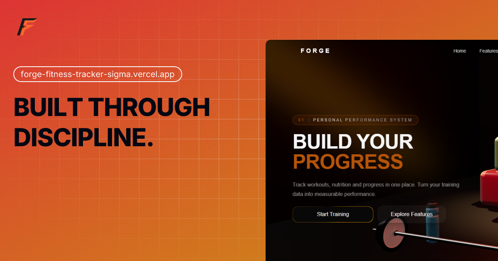

<div align="center">


# Forge

**Workout and nutrition tracker. Log every rep and meal, and turn your training data into measurable progress.**

[](https://forge-fitness-tracker-sigma.vercel.app/)
[](https://github.com/x-hamza47/fitness-tracker/actions)
[](./LICENSE)


[Features](#features) · [Tech Stack](#tech-stack) · [Getting Started](#getting-started) · [Project Structure](#project-structure) · [CI/CD](#cicd) · [Roadmap](#roadmap) · [License](#license) · [Author](#author)

<br />

<a href="https://forge-fitness-tracker-sigma.vercel.app/">
  
</a>

</div>

---

## About

Forge is a personal performance system for people who train seriously. It brings workout logging, nutrition tracking, and progress insights into one place, so training data becomes something you can measure and act on.

**Live site:** https://forge-fitness-tracker-sigma.vercel.app/

## Features

### Landing site

- **Scroll-driven hero** with interactive 3D fitness models (dumbbells, punching bag, water bottle)
- **Animated product sections** covering philosophy, nutrition tracking, and training progress
- **Interactive nutrition target calculator**
- **Live community statistics** (workouts logged, personal records, meals tracked) from the public API
- **Responsive and accessible** layout with semantic markup
- **SEO foundations:** meta tags, Open Graph image, `sitemap.xml`, `robots.txt`, web app manifest

### Application

- **Authentication** for secure user accounts
- **Dashboard** as a single home for your training and nutrition data
- **Workout logging** for exercises, sets, and reps
- **Nutrition tracking** for meals and daily targets
- **Progress charts and insights** to turn logged data into measurable progress

## Tech Stack

| Layer | Technology |
| ----- | ---------- |
| Framework | React, TypeScript, Vite |
| Styling | Tailwind CSS |
| Animation | Motion, GSAP (ScrollTrigger) |
| 3D | Three.js (GLB models) |
| Data fetching | TanStack Query |
| Routing | React Router |
| Icons | Tabler Icons |
| UI components | Custom components, some adapted from Aceternity UI |
| Tooling | ESLint, GitHub Actions CI |
| Deployment | Vercel |

## Getting Started

### Prerequisites

- Node.js 22 or later
- npm

### Installation

```bash
# Clone the repository
git clone https://github.com/x-hamza47/fitness-tracker
cd fitness-tracker

# Install dependencies
npm install

# Start the development server
npm run dev
```

### Environment variables

Create a `.env` file in the project root (it is git-ignored):

```env
VITE_API_URL=http://localhost:5000/api
```

### Scripts

| Command | Description |
| ------- | ----------- |
| `npm run dev` | Start the dev server |
| `npm run build` | Create a production build |
| `npm run lint` | Run ESLint |
| `npm run preview` | Preview the production build |

## Project Structure

```text
src/
├── app/            # Providers and router
├── assets/         # Images, logo, team photos
├── components/
│   ├── common/     # Shared components (navbar)
│   ├── three/      # 3D scene, camera rig, models
│   └── ui/         # Reusable UI components
├── hooks/          # Custom hooks
├── layouts/        # Page layouts
├── lib/            # API client and utilities
├── pages/
│   ├── public/     # Landing page and its sections
│   └── dashboard/  # Authenticated dashboard
└── services/       # API service functions
```

## CI/CD

GitHub Actions (see [`.github/workflows/ci.yml`](.github/workflows/ci.yml)) runs on every push and pull request to `master` and `develop`. The pipeline:

1. Checks out the code
2. Sets up Node.js 22
3. Installs dependencies with `npm ci`
4. Runs ESLint
5. Builds the project

Broken code is caught before it is merged. The site is deployed on Vercel.

## Roadmap

- [x] Landing page
- [x] Nutrition target calculator
- [x] SEO foundations
- [x] Authentication
- [x] Dashboard
- [x] Workout logging
- [x] Nutrition tracking
- [x] Progress charts and insights
- [x] Automated tests

## License

Copyright (c) 2026 Hamza Aamir. All rights reserved.

This code is provided for viewing purposes only. See [LICENSE](./LICENSE) for details.

## Author

**Hamza Aamir**, Full-Stack Developer

[GitHub](https://github.com/x-hamza47) · [LinkedIn](https://www.linkedin.com/in/hamza-aamir-dev/) · [Portfolio](https://hamzaamir-portfolio.web.app/)
